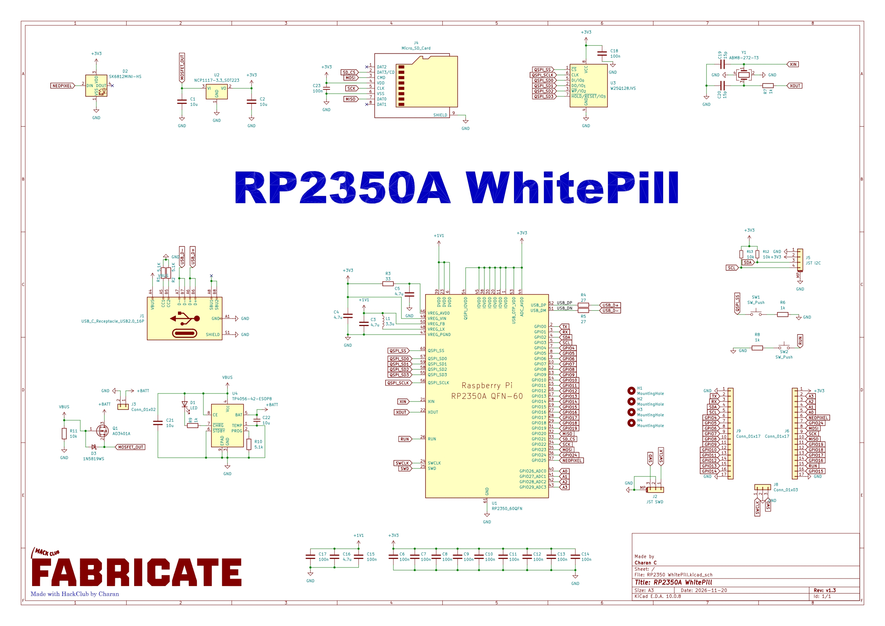
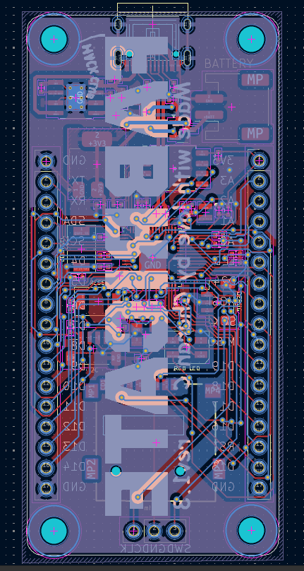

# White Pill

White Pill is a simple RP2350-based board with multiple convenient features built-in.

## Why ?

I wanted to build a devboard to learn more about actual PCB design and electronics, instead of using pre-made boards ;D

## Features:

- RP2350A MCU
- 16MB flash memory
- Built-in lithium battery support
- microSD card reader
- On-board RGB LED on GPIO25 (neopixel)
- QWIIC / Stemma QT I2C connector
- USB-C connector
- JST Debug header

## PCB and schematic:

### Schematic:

### PCB:

## BOM:
check [BOM.csv](/BOM.csv)

## License
[MIT](/LICENSE)